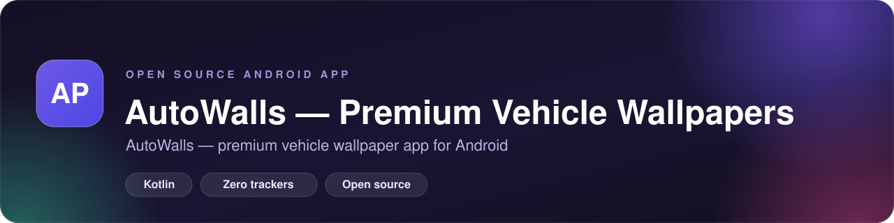
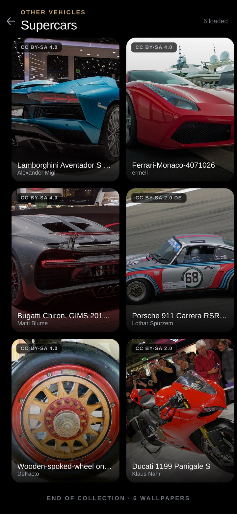
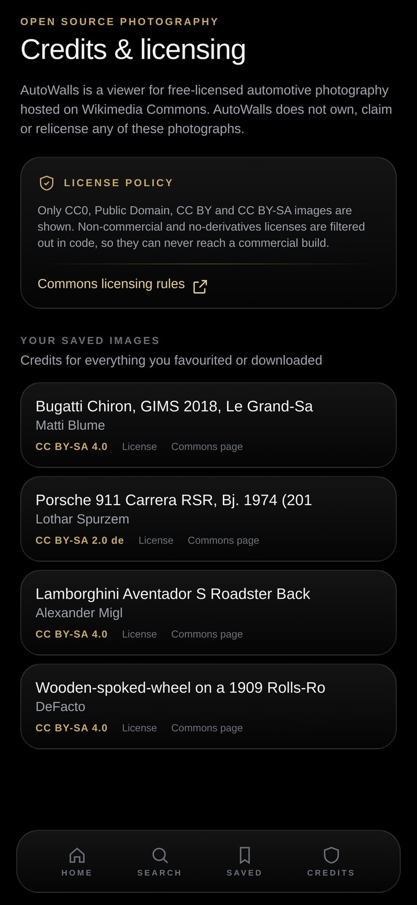

<div align="center">



<a href="https://github.com/technicalnihilist-lgtm/AutoWalls/stargazers"></a>&nbsp;<a href="https://github.com/technicalnihilist-lgtm/AutoWalls/network/members"></a>

<a href="https://github.com/technicalnihilist-lgtm/AutoWalls/releases/latest"></a>

<b>Support the work</b>

  

<sub>Donations aren't live yet — Paytm, UPI, PayPal and Buy&nbsp;Me&nbsp;a&nbsp;Coffee all show <b>coming soon</b>. Until then, a ⭐ star is the best support.</sub>

<a href="https://github.com/technicalnihilist-lgtm/AutoWalls/releases/latest"></a>  <a href="https://github.com/technicalnihilist-lgtm/AutoWalls/releases"></a>

</div>

---

## Screenshots

| Home | Wallpaper detail | Search |
|---|---|---|
|  |  |  |

| Category grid | Saved / offline | Credits & licensing |
|---|---|---|
|  |  |  |

> These are renders of the app's design system (same tokens, layout and real Commons
> photography) produced in a build sandbox without an emulator — not device captures.
> To generate true device screenshots, run `./gradlew :app:testDebugUnitTest` — the
> `ScreenshotTest` renders the real Compose screens with Robolectric and writes PNGs to
> `app/build/screenshots/`. The GitHub Action does this on every push and uploads them as
> the `screenshots` artifact. Photo credits: [screenshots/CREDITS.md](screenshots/CREDITS.md).

## 1. Build & run

```bash
## 2. What is verified

| Check | Status |
|---|---|
| Project compiles (`:app:compileDebugKotlin`) | ✅ clean, no errors |
| Debug APK assembles (`:app:assembleDebug`) | ✅ 11 MB APK produced |
| APK manifest / permissions / minSdk | ✅ inspected with `aapt2 dump badging` |
| Commons API contract (search, pagination, extmetadata) | ✅ validated against the live endpoint |
| Every one of the 42 category queries returns real, licensed images | ✅ validated live (see §4) |
| License filter rejects NC / ND / unverifiable | ✅ rule verified against live metadata |
| Runtime on a physical device / emulator | ⚠️ not run here (no emulator in the build sandbox) |
| Release build with R8 | ⚠️ not completed in the 2 GB build sandbox; config + keep rules are in place |

---

## 3. Image sources and the API

Base endpoint: `https://commons.wikimedia.org/w/api.php`

Search (category feeds, search, pagination):

```
action=query&format=json&formatversion=2
&generator=search&gsrsearch=<query> filetype:bitmap&gsrnamespace=6
&gsrlimit=30&gsroffset=<offset>
&prop=imageinfo&iiprop=url|size|mime|extmetadata|user&iiurlwidth=1200
&iiextmetadatafilter=ObjectName|ImageDescription|Artist|Credit|LicenseShortName|LicenseUrl|
                      UsageTerms|AttributionRequired|DateTimeOriginal
```

Single image (deep links, e.g. restored from a saved favourite):

```
action=query&format=json&formatversion=2&pageids=<id>&prop=imageinfo&...
```

Retrieved per image: original title, full-resolution URL, thumbnail URL (1200 px, plus a
derived 640 px grid variant), photographer/creator (`Artist`, falling back to `Credit` then
uploader), original source page, license name, license URL, description, dimensions, file size,
original date and uploader.

**Pagination** uses the API's `continue.gsroffset`. **Retries:** OkHttp retries connection
failures and 429/5xx up to 3 times; every screen exposes a Retry action and a specific error
message (offline, timeout, rate-limited, HTTP error).

Every request sends a descriptive `User-Agent`, as Wikimedia's API policy requires.

---

## 4. Categories (42)

All queries below were run against the live API; each returns a healthy set of JPEG
photographs that pass the license filter.

**Cars** — Lamborghini, Ferrari, Porsche, Bugatti, McLaren, BMW, Mercedes-Benz, Audi,
Rolls-Royce, Bentley, Toyota, Nissan, Honda, Ford, Chevrolet, Tesla

**Motorcycles** — Kawasaki, Yamaha, Ducati, BMW Motorrad, Suzuki, Honda Bikes, KTM,
Harley-Davidson, Triumph

**Other vehicles** — Supercars, Hypercars, Classic Cars, Electric Cars, Racing Cars,
Formula 1, SUVs, Pickup Trucks, Heavy Trucks, Buses, Aircraft, Helicopters, Private Jets,
Military Aircraft, Ships, Luxury Yachts

The exact search expression for each category lives in `domain/model/VehicleCategory.kt`
(`VehicleCatalog`).

---

## 5. Licensing policy (enforced in code)

`domain/LicensePolicy.kt` is the single gate every image passes through:

- **Allowed:** CC0, Public Domain / PD-*, CC BY, CC BY-SA (any version)
- **Rejected:** anything with `-NC`, `-ND`, "fair use", "non-free", "all rights reserved",
  a missing license, or an unparseable license string

Because AutoWalls is distributed commercially, non-commercial and no-derivatives licenses are
filtered out before an image can ever reach the UI. Images that fail the gate are dropped
silently — they are never shown with placeholder or invented credits.

Attribution surfaces:

1. **License badge** on every card and hero (visible before you even open an image).
2. **Detail screen** — "Photo credit" block: title, creator, uploader, original date, license
   name, plain-language license summary, link to the license deed, link to the original
   Commons page, plus a modification statement (the app shows originals unmodified; previews
   use Wikimedia's standard scaled thumbnail) and an explicit statement that AutoWalls does not
   own the photograph.
3. **Credits tab** — a dedicated page with the license policy and a per-image credit list for
   everything you favourited or downloaded.
4. **Share / copy credit** — every share carries the creator, license and source link.

---

## 6. Features

- **Home:** logo, search entry, daily vehicle wallpaper, featured supercars, trending vehicles,
  popular brands, latest wallpapers, motorcycle collection, luxury collection, recently viewed.
- **Detail:** full-screen cinematic preview, vehicle name, resolution/MP/file size, download,
  set as home / lock / both, favourite, share, save to gallery, copy credit, full attribution.
- **Search:** live debounced search by vehicle name or manufacturer, brand filter chips,
  pagination, empty/error states.
- **Categories:** grouped browser for all 42 categories + per-category paginated grid.
- **Saved:** favourites, offline downloads (with remove) and recently viewed, persisted in Room.
- **Downloads:** full-resolution original streamed by a foreground service with a progress
  notification, stored in app storage for offline use; optional copy into `Pictures/AutoWalls`
  via MediaStore.
- **Performance:** Lazy grids/rows, 640 px grid thumbnails, Coil memory + disk cache, background
  downloads, downsampled bitmap decode before handing an image to `WallpaperManager`
  (max 2560 px) so a 6000 px original never blows up the heap.
- **Duplicate prevention:** per-screen `seenIds` sets plus `distinctBy(id)` in the repository, and
  a stable page-id primary key in Room.

---

## 7. Project map

```
app/src/main/java/com/autowalls/app/
├── AutoWallsApplication.kt        Application, Coil loader, notification channel
├── MainActivity.kt                Compose host, notification permission
├── di/AppContainer.kt             manual dependency graph
├── domain/
│   ├── LicensePolicy.kt           allow/deny rules + license fallback URLs
│   └── model/                     Wallpaper, VehicleCategory, VehicleCatalog (42 categories)
├── data/
│   ├── remote/                    Retrofit API, OkHttp client, DTOs, extmetadata mapper
│   ├── local/                     Room entities, DAO, database
│   ├── repository/                live catalogue, search, daily pick, downloads, persistence
│   └── download/                  foreground DownloadService + progress tracker
├── util/                          WallpaperSetter, GallerySaver, ShareUtils, error mapping
└── ui/                            theme, components, navigation, screens + view models
```

Architecture: unidirectional data flow — Compose screens observe `StateFlow` UI state from
`AndroidViewModel`s; the repository is the single source of truth and the network is always the
source of image data.

---

## 8. Design

True black (`#000000`) AMOLED canvas, dark glassmorphism surfaces (1 px hairline borders, a
very light vertical wash — no heavy gradients or glow), a single metallic champagne accent
(`#C8A96A`), wide-tracked uppercase micro-labels, and large cinematic photography. Icons are
hand-authored vector drawables (no 10,000-icon dependency), so the app stays small and fast.

---

## 9. Changelog

### 1.0.2 — image display fixes
- **Landscape photos are no longer cropped.** The detail screen shows the photograph at its
  natural aspect ratio with `ContentScale.Fit` (letterboxed on black) instead of a full-bleed
  `Crop`, so a wide shot is visible in full.
- **New full-screen viewer.** Tap the photo on the detail screen to open it edge to edge;
  pinch to zoom (up to 5×), drag to pan, double-tap to zoom or reset. It is `Fit`-based and
  works in landscape.
- **Faster loading.** The home feed now publishes each rail the moment it arrives instead of
  blocking on the slowest request; thumbnails for the first 8 items of every rail are
  prefetched into the Coil disk cache; the detail screen shows the already-cached thumbnail
  instantly while the full preview streams in; crossfade cut from 280 ms to 120 ms and the
  image client now allows 12 parallel requests per host.
- Detail screen restructured: image on top, actions and credits below, fixed top bar.

### 1.0.1
- Version bump and a fresh build (`versionCode 2`)
- MIT licence for the app code, explicitly excluding the photographs
- GitHub Actions workflow: builds the debug APK on every push and uploads it as an artifact
  (green run: `AutoWalls-debug-apk`); the screenshot step is wired up but still experimental
- Removed a sandbox-only test dependency; `ScreenshotTest` now uses Robolectric's own
  automatic download on a normal machine

### 1.0.0
- First public build: live Wikimedia Commons feed, 42 categories, licence gate, downloads,
  favourites, offline library, credits screen

## 10. Known limitations

- Runtime behaviour on a device was not exercised in this environment; the build and the API
  contract were verified instead. The APK in the release was built and inspected here, not run.
- The `ScreenshotTest` is **experimental**: it compiles and runs in CI, but every capture still
  ends in `ComposeTimeoutException` because Coil's asynchronous image updates keep the Compose
  composition from ever going idle. A synchronous fake `ImageLoader` (or disabling crossfade in
  test mode) is the missing piece. Until then the screenshots in this repo are renders of the
  design system, not device captures.
- The release build (R8) was not completed here because of the build sandbox's 2 GB / 2-core
  limit; the debug build and the keep rules in `app/proguard-rules.pro` are in place.
- Verification ran with memory-constrained Gradle settings (1.4 GB heap, one worker). The
  delivered `gradle.properties` uses normal desktop defaults.
- "Lock screen" wallpaper requires a device/launcher that supports separate lock wallpapers;
  the app reports a clear message when the OEM blocks it.

---

## 🌍 Languages

<sub>Donations are <b>coming soon</b> in every language below — nothing to pay today, nothing to click.</sub>

<div align="center">

<sub><b>हिन्दी · বাংলা · मराठी · తెలుగు · தமிழ் · ગુજરાતી · ಕನ್ನಡ · മലയാളം · ਪੰਜਾਬੀ · ଓଡ଼ିଆ · অসমীয়া · اردو</b></sub>

</div>

<details>
<summary><b>🌍 Open the same message in 53 languages</b></summary>

**🇮🇳 Indian languages**

- **हिन्दी** (Hindi) — ☕ जल्द ही आ रहा है। · ⭐ अगर आपको यह ऐप और हमारा काम पसंद है, तो कृपया रिपॉजिटरी को स्टार दें और हमें फॉलो करें।
- **বাংলা** (Bengali) — ☕ খুব শিগগিরই আসছে। · ⭐ যদি আপনার এই অ্যাপ এবং আমাদের কাজ ভালো লাগে, তবে অনুগ্রহ করে রিপোজিটরিটিকে একটি স্টার দিন এবং আমাদের ফলো করুন।
- **मराठी** (Marathi) — ☕ लवकरच येत आहे. · ⭐ जर तुम्हाला हे ॲप आणि आमचं काम आवडलं असेल, तर कृपया रिपॉझिटरीला स्टार द्या आणि आम्हाला फॉलो करा.
- **తెలుగు** (Telugu) — ☕ త్వరలో రాబోతోంది. · ⭐ మీకు ఈ యాప్, మా పని నచ్చితే, దయచేసి రిపోజిటరీకి ఒక స్టార్ ఇచ్చి మమ్మల్ని ఫాలో అవ్వండి.
- **தமிழ்** (Tamil) — ☕ விரைவில் வருகிறது. · ⭐ உங்களுக்கு இந்த ஆப்பும் எங்க வேலையும் பிடிச்சிருந்தா, தயவுசெஞ்சு இந்த ரெபாசிட்டரிக்கு ஒரு ஸ்டார்…
- **ગુજરાતી** (Gujarati) — ☕ ટૂંક સમયમાં આવી રહ્યું છે. · ⭐ જો તમને આ એપ અને અમારું કામ ગમતું હોય, તો પ્લીઝ રિપોઝિટરીને સ્ટાર આપો અને અમને ફોલો કરો.
- **ಕನ್ನಡ** (Kannada) — ☕ ಶೀಘ್ರದಲ್ಲೇ ಬರುತ್ತಿದೆ. · ⭐ ನಿಮಗೆ ಈ ಆ್ಯಪ್ ಮತ್ತು ನಮ್ಮ ಕೆಲಸ ಇಷ್ಟವಾದರೆ, ದಯವಿಟ್ಟು ರೆಪೊಸಿಟರಿಗೆ ಸ್ಟಾರ್ ಕೊಡಿ ಮತ್ತು ನಮ್ಮನ್ನು ಫಾಲೋ ಮಾಡಿ.
- **മലയാളം** (Malayalam) — ☕ ഉടൻ വരുന്നു. · ⭐ നിങ്ങൾക്ക് ഈ ആപ്പും ഞങ്ങളുടെ പ്രവർത്തനവും ഇഷ്ടപ്പെട്ടെങ്കിൽ, ദയവായി റെപ്പോസിറ്ററിക്ക് ഒരു സ്റ്റാർ…
- **ਪੰਜਾਬੀ** (Punjabi) — ☕ ਜਲਦੀ ਆ ਰਿਹਾ ਹੈ। · ⭐ ਜੇ ਤੁਹਾਨੂੰ ਇਹ ਐਪ ਅਤੇ ਸਾਡਾ ਕੰਮ ਪਸੰਦ ਹੈ, ਤਾਂ ਕਿਰਪਾ ਕਰਕੇ ਰਿਪੋਜ਼ਟਰੀ ਨੂੰ ਸਟਾਰ ਦਿਓ ਅਤੇ ਸਾਨੂੰ ਫਾਲੋ ਕਰੋ।
- **ଓଡ଼ିଆ** (Odia) — ☕ ଖୁବ୍ ଶୀଘ୍ର ଆସୁଛି। · ⭐ ଯଦି ଆପଣଙ୍କୁ ଏହି ଆପ୍ ଏବଂ ଆମର କାମ ଭଲ ଲାଗୁଛି, ତେବେ ଦୟାକରି ରିପୋଜିଟୋରୀକୁ ଗୋଟିଏ ଷ୍ଟାର୍ ଦିଅନ୍ତୁ ଏବଂ ଆମକୁ ଫଲୋ କରନ୍ତୁ।
- **অসমীয়া** (Assamese) — ☕ অতি সোনকালেই আহি আছে। · ⭐ যদি আপুনি এই এপটো আৰু আমাৰ কাম ভাল পায়, তেন্তে অনুগ্ৰহ কৰি ৰিপজিটৰীটোক এটা ষ্টাৰ দিয়ক আৰু আমাক ফ'ল' কৰক।
- **اردو** (Urdu) — ☕ جلد آرہا ہے۔ · ⭐ اگر آپ کو یہ ایپ اور ہمارا کام پسند آئے تو براہ کرم ریپازٹری کو سٹار دیں اور ہمیں فالو کریں۔
- **संस्कृतम्** (Sanskrit) — ☕ शीघ्रमेव आगच्छति।
- **मैथिली** (Maithili) — ☕ जल्दिये आबि रहल अछि।
- **कोंकणी** (Konkani) — ☕ रोखडेंच येता.
- **کٲشُر** (Kashmiri) — ☕ جَلدی یِوان چھُ۔
- **سنڌي** (Sindhi) — ☕ जल्द अची रह्यो आहे।
- **डोगरी** (Dogri) — ☕ जल्दी आ करदा ऐ।
- **ꯃꯤꯇꯩ ꯂꯣꯟ** (Manipuri) — ☕ ꯑꯊꯨꯕꯥ ꯃꯇꯝꯗꯥ ꯂꯥꯛꯀꯅꯤ꯫
- **बर’** (Bodo) — ☕ थाबैनो फैगोन।
- **ᱥᱟᱱᱛᱟᱲᱤ** (Santali) — ☕ ᱞᱚᱜᱚᱱ ᱦᱤᱡᱩᱜ ᱠᱟᱱᱟ᱾
- **नेपाली** (Nepali) — ☕ छिट्टै आउँदैछ। · ⭐ यदि तपाईंलाई यो एप र हाम्रो काम मन पर्‍यो भने, कृपया रिपोजिटरीलाई स्टार दिनुहोस् र हामीलाई फलो गर्नुहोस्।

**🌍 World languages**

- **العربية** (Arabic) — ☕ قريبًا. · ⭐ إذا أعجبك هذا التطبيق وعملنا، فيرجى منح المستودع نجمة ومتابعتنا.
- **简体中文** (Chinese (Simplified)) — ☕ 即将推出。
- **繁體中文** (Chinese (Traditional)) — ☕ 即將推出。
- **Čeština** (Czech) — ☕ Již brzy.
- **Dansk** (Danish) — ☕ Kommer snart.
- **Nederlands** (Dutch) — ☕ Binnenkort beschikbaar. · ⭐ Vind je deze app en ons werk leuk?
- **Filipino** (Filipino) — ☕ Malapit na.
- **Suomi** (Finnish) — ☕ Tulossa pian.
- **Français** (French) — ☕ Bientôt disponible. · ⭐ Si cette application et notre travail vous plaisent, mettez une étoile au dépôt et suivez-nous.
- **Deutsch** (German) — ☕ Bald verfügbar. · ⭐ Wenn dir diese App und unsere Arbeit gefallen, gib dem Repository einen Stern und folge uns.
- **Ελληνικά** (Greek) — ☕ Έρχεται σύντομα.
- **עברית** (Hebrew) — ☕ בקרוב.
- **Magyar** (Hungarian) — ☕ Hamarosan.
- **Bahasa Indonesia** (Indonesian) — ☕ Segera hadir. · ⭐ Jika kamu suka aplikasi ini dan karya kami, beri bintang pada repositori ini dan ikuti kami.
- **Italiano** (Italian) — ☕ In arrivo.
- **日本語** (Japanese) — ☕ 近日公開。 · ⭐ このアプリと私たちの仕事が気に入ったら、リポジトリにスターを付けてフォローしてください。
- **한국어** (Korean) — ☕ 곧 공개됩니다. · ⭐ 이 앱과 저희 작업이 마음에 드신다면 저장소에 스타를 눌러 주시고 팔로우해 주세요.
- **Bahasa Melayu** (Malay) — ☕ Akan datang.
- **Norsk** (Norwegian) — ☕ Kommer snart.
- **فارسی** (Persian) — ☕ به‌زودی.
- **Polski** (Polish) — ☕ Wkrótce. · ⭐ Jeśli podoba Ci się ta aplikacja i nasza praca, daj repozytorium gwiazdkę i obserwuj nas.
- **Português** (Portuguese) — ☕ Em breve.
- **Română** (Romanian) — ☕ În curând.
- **Русский** (Russian) — ☕ Скоро. · ⭐ Если вам нравится это приложение и наша работа, поставьте звёздочку репозиторию и подпишитесь на нас.
- **Español** (Spanish) — ☕ Muy pronto. · ⭐ Si te gusta esta app y nuestro trabajo, dale una estrella al repositorio y síguenos.
- **Kiswahili** (Swahili) — ☕ Inakuja hivi karibuni.
- **Svenska** (Swedish) — ☕ Kommer snart.
- **ไทย** (Thai) — ☕ เร็ว ๆ นี้
- **Türkçe** (Turkish) — ☕ Çok yakında.
- **Українська** (Ukrainian) — ☕ Незабаром.
- **Tiếng Việt** (Vietnamese) — ☕ Sắp ra mắt. · ⭐ Nếu bạn thích ứng dụng này và công việc của chúng tôi, hãy tặng kho lưu trữ một ngôi sao và theo…

</details>

