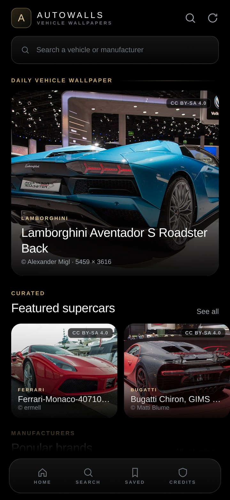
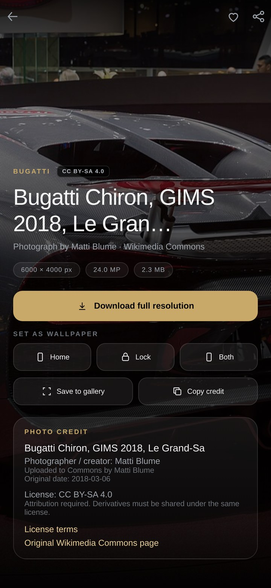
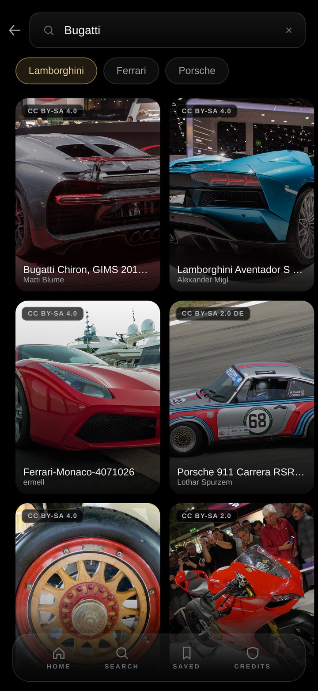
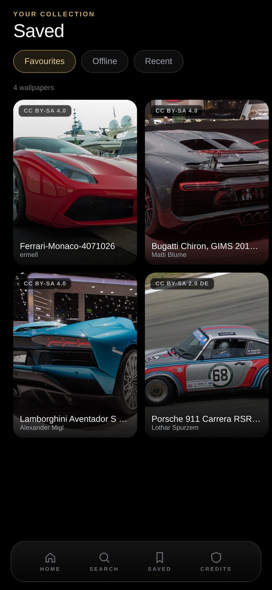

# AutoWalls — Premium Vehicle Wallpapers (Android)

[](https://github.com/technicalnihilist-lgtm/AutoWalls/actions/workflows/build.yml)
[](https://github.com/technicalnihilist-lgtm/AutoWalls/releases/latest)

A complete Android wallpaper app for automotive photography. Every image is fetched **live**
from the Wikimedia Commons API at runtime — nothing is bundled, seeded or faked — and every
image carries its photographer, license name, license URL and original Commons page.

- **Language:** Kotlin
- **UI:** Jetpack Compose + Material 3, AMOLED-black glassmorphism
- **Networking:** Retrofit + OkHttp (Gson)
- **Images:** Coil (memory + 512 MB disk cache, descriptive User-Agent)
- **Persistence:** Room (favourites, offline downloads, recently viewed)
- **Wallpaper:** Android `WallpaperManager` (home / lock / both)
- **minSdk 24 · targetSdk 35 · compileSdk 35 · version 1.0.2 (code 3)**

---

## Screenshots

| Home | Wallpaper detail | Search |
|---|---|---|
|  |  |  |

| Category grid | Saved / offline | Credits & licensing |
|---|---|---|
|  |  |  |

> These are renders of the app's design system (same tokens, layout and real Commons
> photography) produced in a build sandbox without an emulator — not device captures.
> To generate true device screenshots, run `./gradlew :app:testDebugUnitTest` — the
> `ScreenshotTest` renders the real Compose screens with Robolectric and writes PNGs to
> `app/build/screenshots/`. The GitHub Action does this on every push and uploads them as
> the `screenshots` artifact. Photo credits: [screenshots/CREDITS.md](screenshots/CREDITS.md).

## 1. Build & run

```bash
# Android Studio: File ▸ Open ▸ (this folder), then Run ▸ app
# Or from the command line:
./gradlew :app:assembleDebug        # APK at app/build/outputs/apk/debug/
./gradlew :app:installDebug         # to a connected device
```

Requires JDK 17 and the Android SDK (platform 35 + build-tools 35). The Gradle wrapper (8.9)
is included.

[](https://github.com/technicalnihilist-lgtm/AutoWalls/releases/latest/download/AutoWalls-debug.apk)

The installable debug APK (`com.autowalls.app.debug`, 11 MB, minSdk 24) is attached to the
[latest release](https://github.com/technicalnihilist-lgtm/AutoWalls/releases/latest).

---

## 2. What is verified

| Check | Status |
|---|---|
| Project compiles (`:app:compileDebugKotlin`) | ✅ clean, no errors |
| Debug APK assembles (`:app:assembleDebug`) | ✅ 11 MB APK produced |
| APK manifest / permissions / minSdk | ✅ inspected with `aapt2 dump badging` |
| Commons API contract (search, pagination, extmetadata) | ✅ validated against the live endpoint |
| Every one of the 42 category queries returns real, licensed images | ✅ validated live (see §4) |
| License filter rejects NC / ND / unverifiable | ✅ rule verified against live metadata |
| Runtime on a physical device / emulator | ⚠️ not run here (no emulator in the build sandbox) |
| Release build with R8 | ⚠️ not completed in the 2 GB build sandbox; config + keep rules are in place |

---

## 3. Image sources and the API

Base endpoint: `https://commons.wikimedia.org/w/api.php`

Search (category feeds, search, pagination):

```
action=query&format=json&formatversion=2
&generator=search&gsrsearch=<query> filetype:bitmap&gsrnamespace=6
&gsrlimit=30&gsroffset=<offset>
&prop=imageinfo&iiprop=url|size|mime|extmetadata|user&iiurlwidth=1200
&iiextmetadatafilter=ObjectName|ImageDescription|Artist|Credit|LicenseShortName|LicenseUrl|
                      UsageTerms|AttributionRequired|DateTimeOriginal
```

Single image (deep links, e.g. restored from a saved favourite):

```
action=query&format=json&formatversion=2&pageids=<id>&prop=imageinfo&...
```

Retrieved per image: original title, full-resolution URL, thumbnail URL (1200 px, plus a
derived 640 px grid variant), photographer/creator (`Artist`, falling back to `Credit` then
uploader), original source page, license name, license URL, description, dimensions, file size,
original date and uploader.

**Pagination** uses the API's `continue.gsroffset`. **Retries:** OkHttp retries connection
failures and 429/5xx up to 3 times; every screen exposes a Retry action and a specific error
message (offline, timeout, rate-limited, HTTP error).

Every request sends a descriptive `User-Agent`, as Wikimedia's API policy requires.

---

## 4. Categories (42)

All queries below were run against the live API; each returns a healthy set of JPEG
photographs that pass the license filter.

**Cars** — Lamborghini, Ferrari, Porsche, Bugatti, McLaren, BMW, Mercedes-Benz, Audi,
Rolls-Royce, Bentley, Toyota, Nissan, Honda, Ford, Chevrolet, Tesla

**Motorcycles** — Kawasaki, Yamaha, Ducati, BMW Motorrad, Suzuki, Honda Bikes, KTM,
Harley-Davidson, Triumph

**Other vehicles** — Supercars, Hypercars, Classic Cars, Electric Cars, Racing Cars,
Formula 1, SUVs, Pickup Trucks, Heavy Trucks, Buses, Aircraft, Helicopters, Private Jets,
Military Aircraft, Ships, Luxury Yachts

The exact search expression for each category lives in `domain/model/VehicleCategory.kt`
(`VehicleCatalog`).

---

## 5. Licensing policy (enforced in code)

`domain/LicensePolicy.kt` is the single gate every image passes through:

- **Allowed:** CC0, Public Domain / PD-*, CC BY, CC BY-SA (any version)
- **Rejected:** anything with `-NC`, `-ND`, "fair use", "non-free", "all rights reserved",
  a missing license, or an unparseable license string

Because AutoWalls is distributed commercially, non-commercial and no-derivatives licenses are
filtered out before an image can ever reach the UI. Images that fail the gate are dropped
silently — they are never shown with placeholder or invented credits.

Attribution surfaces:

1. **License badge** on every card and hero (visible before you even open an image).
2. **Detail screen** — "Photo credit" block: title, creator, uploader, original date, license
   name, plain-language license summary, link to the license deed, link to the original
   Commons page, plus a modification statement (the app shows originals unmodified; previews
   use Wikimedia's standard scaled thumbnail) and an explicit statement that AutoWalls does not
   own the photograph.
3. **Credits tab** — a dedicated page with the license policy and a per-image credit list for
   everything you favourited or downloaded.
4. **Share / copy credit** — every share carries the creator, license and source link.

---

## 6. Features

- **Home:** logo, search entry, daily vehicle wallpaper, featured supercars, trending vehicles,
  popular brands, latest wallpapers, motorcycle collection, luxury collection, recently viewed.
- **Detail:** full-screen cinematic preview, vehicle name, resolution/MP/file size, download,
  set as home / lock / both, favourite, share, save to gallery, copy credit, full attribution.
- **Search:** live debounced search by vehicle name or manufacturer, brand filter chips,
  pagination, empty/error states.
- **Categories:** grouped browser for all 42 categories + per-category paginated grid.
- **Saved:** favourites, offline downloads (with remove) and recently viewed, persisted in Room.
- **Downloads:** full-resolution original streamed by a foreground service with a progress
  notification, stored in app storage for offline use; optional copy into `Pictures/AutoWalls`
  via MediaStore.
- **Performance:** Lazy grids/rows, 640 px grid thumbnails, Coil memory + disk cache, background
  downloads, downsampled bitmap decode before handing an image to `WallpaperManager`
  (max 2560 px) so a 6000 px original never blows up the heap.
- **Duplicate prevention:** per-screen `seenIds` sets plus `distinctBy(id)` in the repository, and
  a stable page-id primary key in Room.

---

## 7. Project map

```
app/src/main/java/com/autowalls/app/
├── AutoWallsApplication.kt        Application, Coil loader, notification channel
├── MainActivity.kt                Compose host, notification permission
├── di/AppContainer.kt             manual dependency graph
├── domain/
│   ├── LicensePolicy.kt           allow/deny rules + license fallback URLs
│   └── model/                     Wallpaper, VehicleCategory, VehicleCatalog (42 categories)
├── data/
│   ├── remote/                    Retrofit API, OkHttp client, DTOs, extmetadata mapper
│   ├── local/                     Room entities, DAO, database
│   ├── repository/                live catalogue, search, daily pick, downloads, persistence
│   └── download/                  foreground DownloadService + progress tracker
├── util/                          WallpaperSetter, GallerySaver, ShareUtils, error mapping
└── ui/                            theme, components, navigation, screens + view models
```

Architecture: unidirectional data flow — Compose screens observe `StateFlow` UI state from
`AndroidViewModel`s; the repository is the single source of truth and the network is always the
source of image data.

---

## 8. Design

True black (`#000000`) AMOLED canvas, dark glassmorphism surfaces (1 px hairline borders, a
very light vertical wash — no heavy gradients or glow), a single metallic champagne accent
(`#C8A96A`), wide-tracked uppercase micro-labels, and large cinematic photography. Icons are
hand-authored vector drawables (no 10,000-icon dependency), so the app stays small and fast.

---

## 9. Changelog

### 1.0.2 — image display fixes
- **Landscape photos are no longer cropped.** The detail screen shows the photograph at its
  natural aspect ratio with `ContentScale.Fit` (letterboxed on black) instead of a full-bleed
  `Crop`, so a wide shot is visible in full.
- **New full-screen viewer.** Tap the photo on the detail screen to open it edge to edge;
  pinch to zoom (up to 5×), drag to pan, double-tap to zoom or reset. It is `Fit`-based and
  works in landscape.
- **Faster loading.** The home feed now publishes each rail the moment it arrives instead of
  blocking on the slowest request; thumbnails for the first 8 items of every rail are
  prefetched into the Coil disk cache; the detail screen shows the already-cached thumbnail
  instantly while the full preview streams in; crossfade cut from 280 ms to 120 ms and the
  image client now allows 12 parallel requests per host.
- Detail screen restructured: image on top, actions and credits below, fixed top bar.

### 1.0.1
- Version bump and a fresh build (`versionCode 2`)
- MIT licence for the app code, explicitly excluding the photographs
- GitHub Actions workflow: builds the debug APK on every push and uploads it as an artifact
  (green run: `AutoWalls-debug-apk`); the screenshot step is wired up but still experimental
- Removed a sandbox-only test dependency; `ScreenshotTest` now uses Robolectric's own
  automatic download on a normal machine

### 1.0.0
- First public build: live Wikimedia Commons feed, 42 categories, licence gate, downloads,
  favourites, offline library, credits screen

## 10. Known limitations

- Runtime behaviour on a device was not exercised in this environment; the build and the API
  contract were verified instead. The APK in the release was built and inspected here, not run.
- The `ScreenshotTest` is **experimental**: it compiles and runs in CI, but every capture still
  ends in `ComposeTimeoutException` because Coil's asynchronous image updates keep the Compose
  composition from ever going idle. A synchronous fake `ImageLoader` (or disabling crossfade in
  test mode) is the missing piece. Until then the screenshots in this repo are renders of the
  design system, not device captures.
- The release build (R8) was not completed here because of the build sandbox's 2 GB / 2-core
  limit; the debug build and the keep rules in `app/proguard-rules.pro` are in place.
- Verification ran with memory-constrained Gradle settings (1.4 GB heap, one worker). The
  delivered `gradle.properties` uses normal desktop defaults.
- "Lock screen" wallpaper requires a device/launcher that supports separate lock wallpapers;
  the app reports a clear message when the OEM blocks it.

---

## ☕ Donate / Buy me a coffee

**Coming soon** — our donation options are on the way.

| Platform | Status |
| --- | --- |
| Paytm | Coming soon |
| PayPal | Coming soon |
| GPay (Google Pay) | Coming soon |

If you like our work, you can support us with a donation. We are bringing this very soon — **coming soon**.

---

## 🌐 Donate / Buy me a coffee — all languages

**Coming soon** · Paytm · PayPal · GPay — all coming soon.

<details>
<summary><b>🇮🇳 Indian languages</b></summary>

- **Hindi** (हिन्दी): ☕ Donate / Buy me a coffee — जल्द ही आ रहा है। Paytm, PayPal और GPay जल्द ही आ रहे हैं। अगर आपको हमारा काम पसंद है, तो आप डोनेशन देकर हमारा सपोर्ट कर सकते हैं। हम इसे बहुत जल्द ला रहे हैं।
- **Bengali** (বাংলা): ☕ Donate / Buy me a coffee — খুব শিগগিরই আসছে। Paytm, PayPal এবং GPay খুব শিগগিরই আসছে। আমাদের কাজ ভালো লাগলে, আপনি অনুদান দিয়ে আমাদের পাশে দাঁড়াতে পারেন। আমরা খুব তাড়াতাড়ি এটা নিয়ে আসছি।
- **Marathi** (मराठी): ☕ मला कॉफी दान करा / माझ्यासाठी कॉफी विकत घ्या — लवकरच येत आहे. Paytm, PayPal आणि GPay लवकरच येत आहेत. जर तुम्हाला आमचं काम आवडत असेल, तर तुम्ही आम्हाला देणगी देऊन सपोर्ट करू शकता. आम्ही हे लवकरच सुरू करत आहोत.
- **Telugu** (తెలుగు): ☕ నాకు కాఫీ కొనివ్వండి / విరాళం ఇవ్వండి — త్వరలో రాబోతోంది. Paytm, PayPal మరియు GPay త్వరలో రాబోతున్నాయి. మా పని మీకు నచ్చితే, మీరు విరాళం ఇవ్వడం ద్వారా మాకు మద్దతు ఇవ్వవచ్చు. దీన్ని మేము త్వరలోనే తీసుకువస్తున్నాము.
- **Tamil** (தமிழ்): ☕ எனக்கு ஒரு காபி வாங்கிக் கொடுங்கள் / நன்கொடை — விரைவில் வருகிறது. Paytm, PayPal மற்றும் GPay விரைவில் வரவுள்ளன. எங்களுடைய வேலை உங்களுக்குப் பிடித்திருந்தால், நன்கொடை அளித்து நீங்கள் எங்களுக்கு ஆதரவளிக்கலாம். இதை நாங்கள் விரைவில் கொண்டு வருகிறோம்.
- **Gujarati** (ગુજરાતી): ☕ મને કોફી દાન કરો / કોફી ખરીદો — ટૂંક સમયમાં આવી રહ્યું છે. Paytm, PayPal અને GPay ટૂંક સમયમાં આવી રહ્યા છે. જો તમને અમારું કામ ગમે, તો તમે અમને દાન આપીને સપોર્ટ કરી શકો છો. અમે તેને બહુ જલ્દી લાવી રહ્યા છીએ.
- **Kannada** (ಕನ್ನಡ): ☕ ಡೊನೇಟ್ / ನನಗೆ ಒಂದು ಕಾಫಿ ಕೊಡಿಸಿ — ಶೀಘ್ರದಲ್ಲೇ ಬರುತ್ತಿದೆ. Paytm, PayPal ಮತ್ತು GPay ಶೀಘ್ರದಲ್ಲೇ ಬರಲಿವೆ. ನಿಮಗೆ ನಮ್ಮ ಕೆಲಸ ಇಷ್ಟವಾದರೆ, ನೀವು ದೇಣಿಗೆ ನೀಡುವ ಮೂಲಕ ನಮಗೆ ಬೆಂಬಲ ನೀಡಬಹುದು. ನಾವು ಇದನ್ನು ಬಹಳ ಶೀಘ್ರದಲ್ಲೇ ತರುತ್ತಿದ್ದೇವೆ.
- **Malayalam** (മലയാളം): ☕ Donate / Buy me a coffee — ഉടൻ വരുന്നു. Paytm, PayPal, GPay എന്നിവ ഉടൻ വരുന്നു. ഞങ്ങളുടെ വർക്കുകൾ നിങ്ങൾക്ക് ഇഷ്ടമാണെങ്കിൽ, ഒരു സംഭാവന നൽകി ഞങ്ങളെ പിന്തുണയ്ക്കാം. ഞങ്ങൾ ഇത് വളരെ വേഗം കൊണ്ടുവരുന്നുണ്ട്.
- **Odia** (ଓଡ଼ିଆ): ☕ ମୋତେ କଫି କିଣି ଦିଅନ୍ତୁ / ଡୋନେଟ୍ କରନ୍ତୁ — ଖୁବ୍ ଶୀଘ୍ର ଆସୁଛି। Paytm, PayPal ଏବଂ GPay ଖୁବ୍ ଶୀଘ୍ର ଆସୁଛି। ଯଦି ଆପଣଙ୍କୁ ଆମ କାମ ପସନ୍ଦ, ତେବେ ଆପଣ ଆମକୁ ଡୋନେସନ୍ ଦେଇ ସପୋର୍ଟ କରିପାରିବେ। ଆମେ ଏହାକୁ ଖୁବ୍ ଶୀଘ୍ର ଆଣିବୁ।
- **Punjabi** (ਪੰਜਾਬੀ): ☕ ਮੈਨੂੰ ਕੌਫੀ ਦਾਨ ਕਰੋ / ਮੇਰੇ ਲਈ ਕੌਫੀ ਖਰੀਦੋ — ਜਲਦੀ ਆ ਰਿਹਾ ਹੈ। Paytm, PayPal ਅਤੇ GPay ਜਲਦੀ ਆ ਰਹੇ ਹਨ। ਜੇਕਰ ਤੁਹਾਨੂੰ ਸਾਡਾ ਕੰਮ ਪਸੰਦ ਹੈ, ਤਾਂ ਤੁਸੀਂ ਦਾਨ ਦੇ ਕੇ ਸਾਡਾ ਸਾਥ ਦੇ ਸਕਦੇ ਹੋ। ਅਸੀਂ ਇਸਨੂੰ ਬਹੁਤ ਜਲਦੀ ਲੈ ਕੇ ਆ ਰਹੇ ਹਾਂ।
- **Assamese** (অসমীয়া): ☕ Donate / Buy me a coffee — অতি সোনকালেই আহি আছে। Paytm, PayPal আৰু GPay অতি সোনকালেই আহি আছে। যদি আপুনি আমাৰ কাম ভাল পায়, তেন্তে আপুনি দান কৰি আমাক সহায় কৰিব পাৰে। আমি এইটো অতি সোনকালেই লৈ আহি আছোঁ।
- **Urdu** (اردو): ☕ مجھے کافی ڈونیٹ / خریدیں — جلد آرہا ہے۔ Paytm، PayPal اور GPay جلد آرہے ہیں۔ اگر آپ کو ہمارا کام پسند ہے، تو آپ ڈونیشن دے کر ہماری مدد کر سکتے ہیں۔ ہم اسے بہت جلد لا رہے ہیں۔
- **Nepali** (नेपाली): ☕ मलाई कफी किनिदिनुहोस् / दान गर्नुहोस् — छिट्टै आउँदैछ। Paytm, PayPal र GPay पनि छिट्टै आउँदैछन्। यदि तपाईंलाई हाम्रो काम मन पर्छ भने, तपाईंले हामीलाई दान गरेर सहयोग गर्न सक्नुहुन्छ। हामी यो सुविधा धेरै चाँडै ल्याउँदैछौं।
- **Sanskrit** (संस्कृतम्): ☕ मह्यं काफीं क्रीणन्तु / दानं कुर्वन्तु — शीघ्रमेव आगच्छति। Paytm, PayPal तथा GPay अपि शीघ्रमेव आगच्छन्ति। यदि भवन्तः अस्माकं कार्यं रोचन्ते, तर्हि दानं कृत्वा अस्मान् समर्थयितुं शक्नुवन्ति। वयं तत् शीघ्रमेव आनयामः।
- **Konkani** (कोंकणी): ☕ म्हाका कॉफी दान करात / म्हजे खातीर कॉफी घेयात — रोखडेंच येता. Paytm, PayPal आनी GPay रोखडेंच येतले. तुमकां आमचें काम आवडल्यार, तुमी आमकां देणगी दिवन आदार करूंक शकतात. आमी तें खूब बेगीन हाडटात.
- **Maithili** (मैथिली): ☕ हमरा लेल कॉफी डोनेट करू / खरीदू — जल्दिये आबि रहल अछि। Paytm, PayPal आ GPay जल्दिये आबि रहल अछि। जँ अहाँकेँ हमर काज नीक लागैत अछि, तँ अहाँ दान कऽ कऽ हमर समर्थन कऽ सकैत छी। हम एकरा बहुत जल्दी लाबि रहल छी।
- **Kashmiri** (کٲشُر): ☕ مےٚ دِیِو اَکھ کافی — جَلدی یِوان چھُ۔ Paytm, PayPal تہٕ GPay چھِ جَلدی یِوان۔ اَگر تُہؠ سٲنؠ کٲم پَسَند چھِو کَران، تُہؠ ہیٚکِو اَسے اَکھ ڈونیشَن دِتھ سَپورٹ کٔرِتھ۔ اَسؠ چھِ یہِ واریاہ جَلدی اَنان۔
- **Sindhi** (سنڌي): ☕ डोनेट / मूंखे हिक कॉफी वठायो — जल्द अची रह्यो आहे। Paytm, PayPal ऐं GPay जल्द अची रह्या आहिन। जेकडहिं तव्हां खे असां जो कमु वणंदो आहे, त तव्हां असां खे डोनेशन डई सपोर्ट करे सघो था। असीं इहो डाढो जल्द आणी रह्या आहियूं।
- **Dogri** (डोगरी): ☕ डोनेट / मेरे लेई इक कॉफी खरीदो — जल्दी आ करदा ऐ। Paytm, PayPal ते GPay जल्दी आ करदे न। जेकर तुसेंगी साढ़ा कम्म पसंद ऐ, तां तुस साढ़ी मदद दान देइयै करी सकदे ओ। अस इसगी बड़ा जल्दी लेई आ करदे आं।
- **Manipuri** (ꯃꯤꯇꯩ ꯂꯣꯟ): ☕ ꯗꯣꯅꯦꯠ / ꯑꯩꯉꯣꯟꯗꯥ ꯀꯣꯐꯤ ꯑꯃꯥ ꯂꯩꯕꯤꯔꯛꯎ — ꯑꯊꯨꯕꯥ ꯃꯇꯝꯗꯥ ꯂꯥꯛꯀꯅꯤ꯫ Paytm, PayPal ꯑꯃꯁꯨꯡ GPay ꯑꯊꯨꯕꯥ ꯃꯇꯝꯗꯥ ꯂꯥꯛꯀꯅꯤ꯫ ꯀꯔꯤꯒꯨꯝꯕꯥ ꯅꯈꯣꯌꯅꯥ ꯑꯩꯈꯣꯌꯒꯤ ꯊꯕꯛ ꯑꯁꯤ ꯄꯥꯝꯂꯕꯗꯤ, ꯅꯈꯣꯌꯅꯥ ꯗꯣꯅꯦꯁꯟ ꯑꯃꯒꯥ ꯂꯣꯌꯅꯅꯥ ꯑꯩꯈꯣꯌꯕꯨ ꯃꯇꯦꯡ ꯄꯥꯡꯕꯤꯕꯥ ꯌꯥꯏ꯫ ꯑꯩꯈꯣꯌꯅꯥ ꯃꯁꯤ ꯑꯊꯨꯕꯥ ꯃꯇꯝꯗꯥ ꯄꯨꯔꯛꯂꯤ꯫
- **Bodo** (बर’): ☕ आंनो कफि बायना हो — थाबैनो फैगोन। Paytm, PayPal आरो GPay आ थाबैनो फैगोन। जुदि नोंथांमोना जोंनि हाबाखौ मोजां मोनो, नोंथांमोना जोंखौ दान होनानै मदद खालामनो हागोन। जों बेखौ थाबैनो लाबोगोन।
- **Santali** (ᱥᱟᱱᱛᱟᱲᱤ): ☕ ᱫᱟᱱ / ᱤᱧ ᱢᱤᱫ ᱠᱚᱯᱷᱤ ᱠᱤᱨᱤᱧ ᱤᱧ — ᱞᱚᱜᱚᱱ ᱦᱤᱡᱩᱜ ᱠᱟᱱᱟ᱾ Paytm, PayPal ᱟᱨ GPay ᱞᱚᱜᱚᱱ ᱦᱤᱡᱩᱜ ᱠᱟᱱᱟ᱾ ᱡᱩᱫᱤ ᱟᱞᱮᱭᱟᱜ ᱠᱟᱹᱢᱤ ᱯᱮ ᱠᱩᱥᱤᱭᱟᱜ ᱠᱟᱱᱟ, ᱮᱱᱠᱷᱟᱱ ᱫᱟᱱ ᱠᱟᱛᱮ ᱟᱞᱮ ᱜᱚᱲᱚ ᱫᱟᱲᱮᱭᱟᱯᱮᱭᱟ ᱯᱮ᱾ ᱟᱞᱮ ᱱᱚᱶᱟ ᱟᱹᱰᱤ ᱞᱚᱜᱚᱱ ᱞᱮ ᱟᱹᱜᱩᱭᱮᱫᱟ᱾

</details>

<details>
<summary><b>🌍 Global languages</b></summary>

- **Spanish** (Español): ☕ Donar / Invítame un café — Muy pronto. Paytm, PayPal y GPay estarán disponibles muy pronto. Si te gusta nuestro trabajo, puedes apoyarnos con una donación. Lo estamos lanzando muy pronto.
- **French** (Français): ☕ Faire un don / Offrez-moi un café — Bientôt disponible. Paytm, PayPal et GPay arrivent très bientôt. Si vous aimez notre travail, vous pouvez nous soutenir avec un don. Nous le mettons en place très bientôt.
- **German** (Deutsch): ☕ Spenden / Spendier mir einen Kaffee — Bald verfügbar. Paytm, PayPal und GPay kommen sehr bald. Wenn dir unsere Arbeit gefällt, kannst du uns mit einer Spende unterstützen. Wir bringen es sehr bald.
- **Portuguese** (Português): ☕ Doar / Pague-me um café — Em breve. Paytm, PayPal e GPay chegam em breve. Se você gosta do nosso trabalho, pode nos apoiar com uma doação. Estamos trazendo isso muito em breve.
- **Italian** (Italiano): ☕ Dona / Offrimi un caffè — In arrivo. Paytm, PayPal e GPay arrivano presto. Se ti piace il nostro lavoro, puoi sostenerci con una donazione. Lo stiamo lanciando molto presto.
- **Dutch** (Nederlands): ☕ Doneer / Trakteer me op een koffie — Binnenkort beschikbaar. Paytm, PayPal en GPay komen binnenkort. Als je ons werk leuk vindt, kun je ons steunen met een donatie. We brengen dit heel binnenkort.
- **Polish** (Polski): ☕ Przekaż datek / Postaw mi kawę — Wkrótce. Paytm, PayPal i GPay już wkrótce. Jeśli podoba Ci się nasza praca, możesz nas wesprzeć datkiem. Wprowadzamy to bardzo szybko.
- **Russian** (Русский): ☕ Пожертвовать / Купи мне кофе — Скоро. Paytm, PayPal и GPay появятся совсем скоро. Если вам нравится наша работа, вы можете поддержать нас пожертвованием. Мы запускаем это очень скоро.
- **Ukrainian** (Українська): ☕ Пожертвувати / Купи мені каву — Незабаром. Paytm, PayPal і GPay з'являться дуже скоро. Якщо вам подобається наша робота, ви можете підтримати нас пожертвою. Ми запускаємо це дуже скоро.
- **Turkish** (Türkçe): ☕ Bağış yap / Bana bir kahve ısmarla — Çok yakında. Paytm, PayPal ve GPay çok yakında geliyor. İşimizi beğendiyseniz bağışla bizi destekleyebilirsiniz. Çok yakında sunuyoruz.
- **Arabic** (العربية): ☕ تبرّع / اشترِ لي قهوة — قريبًا. Paytm وPayPal وGPay ستتوفر قريبًا جدًا. إذا أعجبك عملنا، يمكنك دعمنا بالتبرع. نطرحه قريبًا جدًا.
- **Persian** (فارسی): ☕ کمک مالی / برایم یک قهوه بخر — به‌زودی. Paytm، PayPal و GPay به‌زودی اضافه می‌شوند. اگر کار ما را دوست دارید، می‌توانید با یک کمک مالی از ما حمایت کنید. این قابلیت را خیلی زود اضافه می‌کنیم.
- **Hebrew** (עברית): ☕ תרומה / קנו לי קפה — בקרוב. Paytm, PayPal ו-GPay יגיעו בקרוב מאוד. אם אתם אוהבים את העבודה שלנו, תוכלו לתמוך בנו בתרומה. אנחנו מביאים את זה בקרוב מאוד.
- **Indonesian** (Bahasa Indonesia): ☕ Donasi / Traktir saya kopi — Segera hadir. Paytm, PayPal, dan GPay segera hadir. Jika Anda menyukai karya kami, Anda dapat mendukung kami dengan donasi. Kami akan menghadirkannya segera.
- **Malay** (Bahasa Melayu): ☕ Derma / Belanja saya kopi — Akan datang. Paytm, PayPal dan GPay akan datang tidak lama lagi. Jika anda suka hasil kerja kami, anda boleh menyokong kami dengan derma. Kami akan membawanya tidak lama lagi.
- **Vietnamese** (Tiếng Việt): ☕ Quyên góp / Mời tôi một ly cà phê — Sắp ra mắt. Paytm, PayPal và GPay sẽ sớm ra mắt. Nếu bạn thích công việc của chúng tôi, bạn có thể ủng hộ bằng một khoản quyên góp. Chúng tôi sẽ sớm mang tính năng này đến.
- **Thai** (ไทย): ☕ บริจาค / เลี้ยงกาแฟฉันสักแก้ว — เร็ว ๆ นี้ Paytm, PayPal และ GPay กำลังจะมาเร็ว ๆ นี้ หากคุณชอบผลงานของเรา คุณสามารถสนับสนุนเราด้วยการบริจาค เรากำลังจะเปิดให้ใช้เร็ว ๆ นี้
- **Japanese** (日本語): ☕ 寄付 / コーヒーをおごる — 近日公開。Paytm、PayPal、GPay も近日対応予定です。私たちの仕事を気に入っていただけたら、寄付で支援できます。まもなく公開します。
- **Korean** (한국어): ☕ 후원 / 커피 한 잔 사주기 — 곧 공개됩니다. Paytm, PayPal, GPay도 곧 지원됩니다. 저희 작업이 마음에 드신다면 후원으로 지원하실 수 있습니다. 곧 선보이겠습니다.
- **Chinese (Simplified)** (简体中文): ☕ 捐赠 / 请我喝杯咖啡 — 即将推出。Paytm、PayPal 和 GPay 即将上线。如果你喜欢我们的作品，可以通过捐赠支持我们。我们很快就会推出。
- **Chinese (Traditional)** (繁體中文): ☕ 捐贈 / 請我喝杯咖啡 — 即將推出。Paytm、PayPal 和 GPay 即將上線。如果你喜歡我們的作品，可以透過捐贈支持我們。我們很快就會推出。
- **Greek** (Ελληνικά): ☕ Δωρεά / Κέρασέ με έναν καφέ — Έρχεται σύντομα. Paytm, PayPal και GPay έρχονται σύντομα. Αν σας αρέσει η δουλειά μας, μπορείτε να μας στηρίξετε με μια δωρεά. Το φέρνουμε πολύ σύντομα.
- **Czech** (Čeština): ☕ Darovat / Kup mi kávu — Již brzy. Paytm, PayPal a GPay budou brzy k dispozici. Pokud se vám naše práce líbí, můžete nás podpořit darem. Přinášíme to velmi brzy.
- **Romanian** (Română): ☕ Donează / Cumpără-mi o cafea — În curând. Paytm, PayPal și GPay vor fi disponibile în curând. Dacă îți place munca noastră, ne poți susține cu o donație. O aducem foarte curând.
- **Hungarian** (Magyar): ☕ Adományozás / Hívj meg egy kávéra — Hamarosan. A Paytm, a PayPal és a GPay hamarosan elérhető. Ha tetszik a munkánk, adománnyal támogathatsz minket. Nagyon hamarosan elhozzuk.
- **Swedish** (Svenska): ☕ Donera / Bjud mig på en kaffe — Kommer snart. Paytm, PayPal och GPay kommer snart. Om du gillar vårt arbete kan du stötta oss med en donation. Vi lanserar det mycket snart.
- **Danish** (Dansk): ☕ Donér / Køb en kaffe til mig — Kommer snart. Paytm, PayPal og GPay kommer snart. Hvis du kan lide vores arbejde, kan du støtte os med en donation. Vi kommer med det meget snart.
- **Norwegian** (Norsk): ☕ Doner / Kjøp en kaffe til meg — Kommer snart. Paytm, PayPal og GPay kommer snart. Hvis du liker arbeidet vårt, kan du støtte oss med en donasjon. Vi lanserer det svært snart.
- **Finnish** (Suomi): ☕ Lahjoita / Tarjoa minulle kahvi — Tulossa pian. Paytm, PayPal ja GPay tulevat pian. Jos pidät työstämme, voit tukea meitä lahjoituksella. Tuomme sen hyvin pian.
- **Swahili** (Kiswahili): ☕ Changia / Ninunulie kahawa — Inakuja hivi karibuni. Paytm, PayPal na GPay zinakuja hivi karibuni. Ikiwa unapenda kazi yetu, unaweza kutusaidia kwa mchango. Tunaileta hivi karibuni.
- **Filipino** (Filipino): ☕ Mag-donate / Bilhan mo ako ng kape — Malapit na. Paparating na ang Paytm, PayPal at GPay. Kung gusto mo ang aming gawa, matutulungan mo kami sa pamamagitan ng donasyon. Ilalabas namin ito sa lalong madaling panahon.

</details>
