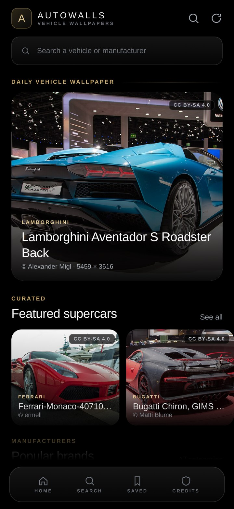
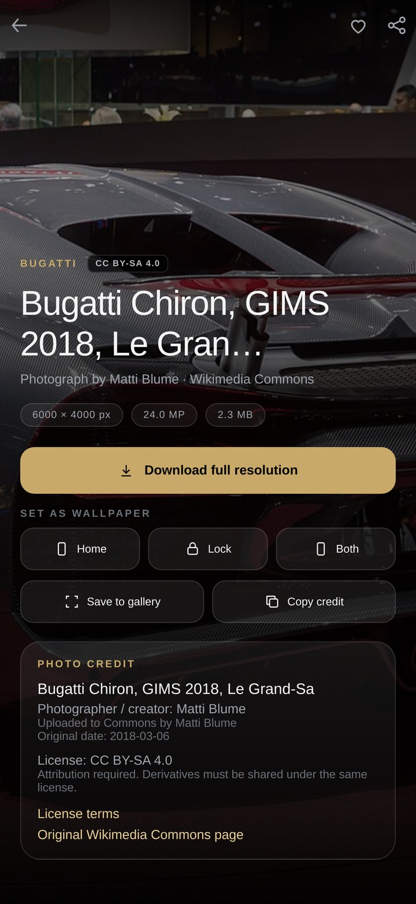
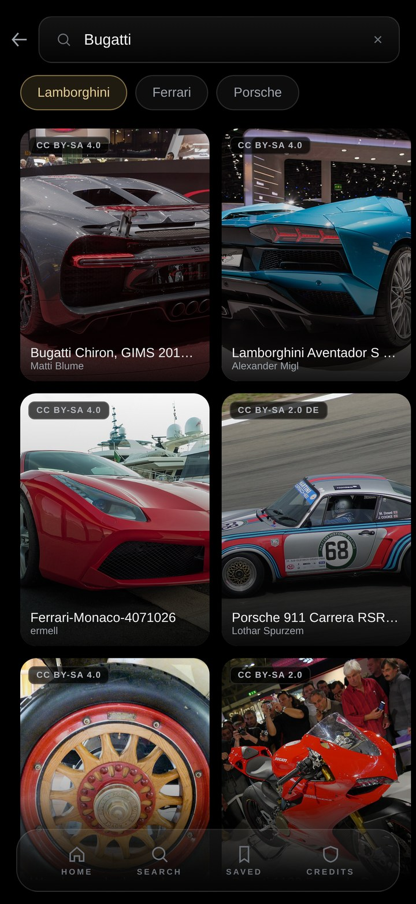
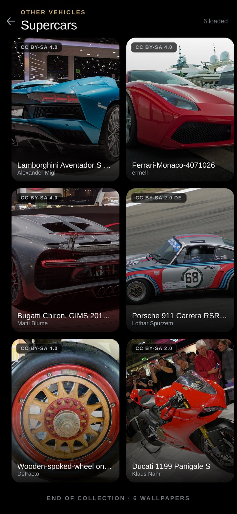
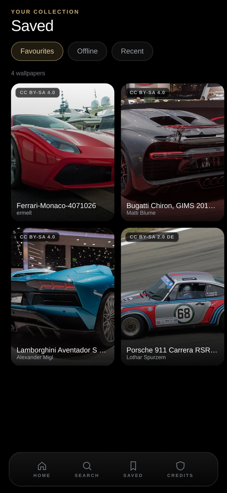
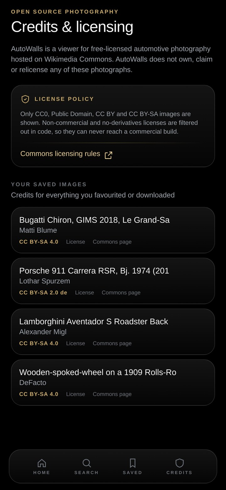

# AutoWalls — Premium Vehicle Wallpapers (Android)

[](https://github.com/technicalnihilist-lgtm/AutoWalls/actions/workflows/build.yml)
[](https://github.com/technicalnihilist-lgtm/AutoWalls/releases/latest)

A complete Android wallpaper app for automotive photography. Every image is fetched **live**
from the Wikimedia Commons API at runtime — nothing is bundled, seeded or faked — and every
image carries its photographer, license name, license URL and original Commons page.

- **Language:** Kotlin
- **UI:** Jetpack Compose + Material 3, AMOLED-black glassmorphism
- **Networking:** Retrofit + OkHttp (Gson)
- **Images:** Coil (memory + 512 MB disk cache, descriptive User-Agent)
- **Persistence:** Room (favourites, offline downloads, recently viewed)
- **Wallpaper:** Android `WallpaperManager` (home / lock / both)
- **minSdk 24 · targetSdk 35 · compileSdk 35 · version 1.0.1 (code 2)**

---

## Screenshots

| Home | Wallpaper detail | Search |
|---|---|---|
|  |  |  |

| Category grid | Saved / offline | Credits & licensing |
|---|---|---|
|  |  |  |

> These are renders of the app's design system (same tokens, layout and real Commons
> photography) produced in a build sandbox without an emulator — not device captures.
> To generate true device screenshots, run `./gradlew :app:testDebugUnitTest` — the
> `ScreenshotTest` renders the real Compose screens with Robolectric and writes PNGs to
> `app/build/screenshots/`. The GitHub Action does this on every push and uploads them as
> the `screenshots` artifact. Photo credits: [screenshots/CREDITS.md](screenshots/CREDITS.md).

## 1. Build & run

```bash
# Android Studio: File ▸ Open ▸ (this folder), then Run ▸ app
# Or from the command line:
./gradlew :app:assembleDebug        # APK at app/build/outputs/apk/debug/
./gradlew :app:installDebug         # to a connected device
```

Requires JDK 17 and the Android SDK (platform 35 + build-tools 35). The Gradle wrapper (8.9)
is included.

[](https://github.com/technicalnihilist-lgtm/AutoWalls/releases/latest/download/AutoWalls-debug.apk)

The installable debug APK (`com.autowalls.app.debug`, 11 MB, minSdk 24) is attached to the
[latest release](https://github.com/technicalnihilist-lgtm/AutoWalls/releases/latest).

---

## 2. What is verified

| Check | Status |
|---|---|
| Project compiles (`:app:compileDebugKotlin`) | ✅ clean, no errors |
| Debug APK assembles (`:app:assembleDebug`) | ✅ 11 MB APK produced |
| APK manifest / permissions / minSdk | ✅ inspected with `aapt2 dump badging` |
| Commons API contract (search, pagination, extmetadata) | ✅ validated against the live endpoint |
| Every one of the 42 category queries returns real, licensed images | ✅ validated live (see §4) |
| License filter rejects NC / ND / unverifiable | ✅ rule verified against live metadata |
| Runtime on a physical device / emulator | ⚠️ not run here (no emulator in the build sandbox) |
| Release build with R8 | ⚠️ not completed in the 2 GB build sandbox; config + keep rules are in place |

---

## 3. Image sources and the API

Base endpoint: `https://commons.wikimedia.org/w/api.php`

Search (category feeds, search, pagination):

```
action=query&format=json&formatversion=2
&generator=search&gsrsearch=<query> filetype:bitmap&gsrnamespace=6
&gsrlimit=30&gsroffset=<offset>
&prop=imageinfo&iiprop=url|size|mime|extmetadata|user&iiurlwidth=1200
&iiextmetadatafilter=ObjectName|ImageDescription|Artist|Credit|LicenseShortName|LicenseUrl|
                      UsageTerms|AttributionRequired|DateTimeOriginal
```

Single image (deep links, e.g. restored from a saved favourite):

```
action=query&format=json&formatversion=2&pageids=<id>&prop=imageinfo&...
```

Retrieved per image: original title, full-resolution URL, thumbnail URL (1200 px, plus a
derived 640 px grid variant), photographer/creator (`Artist`, falling back to `Credit` then
uploader), original source page, license name, license URL, description, dimensions, file size,
original date and uploader.

**Pagination** uses the API's `continue.gsroffset`. **Retries:** OkHttp retries connection
failures and 429/5xx up to 3 times; every screen exposes a Retry action and a specific error
message (offline, timeout, rate-limited, HTTP error).

Every request sends a descriptive `User-Agent`, as Wikimedia's API policy requires.

---

## 4. Categories (42)

All queries below were run against the live API; each returns a healthy set of JPEG
photographs that pass the license filter.

**Cars** — Lamborghini, Ferrari, Porsche, Bugatti, McLaren, BMW, Mercedes-Benz, Audi,
Rolls-Royce, Bentley, Toyota, Nissan, Honda, Ford, Chevrolet, Tesla

**Motorcycles** — Kawasaki, Yamaha, Ducati, BMW Motorrad, Suzuki, Honda Bikes, KTM,
Harley-Davidson, Triumph

**Other vehicles** — Supercars, Hypercars, Classic Cars, Electric Cars, Racing Cars,
Formula 1, SUVs, Pickup Trucks, Heavy Trucks, Buses, Aircraft, Helicopters, Private Jets,
Military Aircraft, Ships, Luxury Yachts

The exact search expression for each category lives in `domain/model/VehicleCategory.kt`
(`VehicleCatalog`).

---

## 5. Licensing policy (enforced in code)

`domain/LicensePolicy.kt` is the single gate every image passes through:

- **Allowed:** CC0, Public Domain / PD-*, CC BY, CC BY-SA (any version)
- **Rejected:** anything with `-NC`, `-ND`, "fair use", "non-free", "all rights reserved",
  a missing license, or an unparseable license string

Because AutoWalls is distributed commercially, non-commercial and no-derivatives licenses are
filtered out before an image can ever reach the UI. Images that fail the gate are dropped
silently — they are never shown with placeholder or invented credits.

Attribution surfaces:

1. **License badge** on every card and hero (visible before you even open an image).
2. **Detail screen** — "Photo credit" block: title, creator, uploader, original date, license
   name, plain-language license summary, link to the license deed, link to the original
   Commons page, plus a modification statement (the app shows originals unmodified; previews
   use Wikimedia's standard scaled thumbnail) and an explicit statement that AutoWalls does not
   own the photograph.
3. **Credits tab** — a dedicated page with the license policy and a per-image credit list for
   everything you favourited or downloaded.
4. **Share / copy credit** — every share carries the creator, license and source link.

---

## 6. Features

- **Home:** logo, search entry, daily vehicle wallpaper, featured supercars, trending vehicles,
  popular brands, latest wallpapers, motorcycle collection, luxury collection, recently viewed.
- **Detail:** full-screen cinematic preview, vehicle name, resolution/MP/file size, download,
  set as home / lock / both, favourite, share, save to gallery, copy credit, full attribution.
- **Search:** live debounced search by vehicle name or manufacturer, brand filter chips,
  pagination, empty/error states.
- **Categories:** grouped browser for all 42 categories + per-category paginated grid.
- **Saved:** favourites, offline downloads (with remove) and recently viewed, persisted in Room.
- **Downloads:** full-resolution original streamed by a foreground service with a progress
  notification, stored in app storage for offline use; optional copy into `Pictures/AutoWalls`
  via MediaStore.
- **Performance:** Lazy grids/rows, 640 px grid thumbnails, Coil memory + disk cache, background
  downloads, downsampled bitmap decode before handing an image to `WallpaperManager`
  (max 2560 px) so a 6000 px original never blows up the heap.
- **Duplicate prevention:** per-screen `seenIds` sets plus `distinctBy(id)` in the repository, and
  a stable page-id primary key in Room.

---

## 7. Project map

```
app/src/main/java/com/autowalls/app/
├── AutoWallsApplication.kt        Application, Coil loader, notification channel
├── MainActivity.kt                Compose host, notification permission
├── di/AppContainer.kt             manual dependency graph
├── domain/
│   ├── LicensePolicy.kt           allow/deny rules + license fallback URLs
│   └── model/                     Wallpaper, VehicleCategory, VehicleCatalog (42 categories)
├── data/
│   ├── remote/                    Retrofit API, OkHttp client, DTOs, extmetadata mapper
│   ├── local/                     Room entities, DAO, database
│   ├── repository/                live catalogue, search, daily pick, downloads, persistence
│   └── download/                  foreground DownloadService + progress tracker
├── util/                          WallpaperSetter, GallerySaver, ShareUtils, error mapping
└── ui/                            theme, components, navigation, screens + view models
```

Architecture: unidirectional data flow — Compose screens observe `StateFlow` UI state from
`AndroidViewModel`s; the repository is the single source of truth and the network is always the
source of image data.

---

## 8. Design

True black (`#000000`) AMOLED canvas, dark glassmorphism surfaces (1 px hairline borders, a
very light vertical wash — no heavy gradients or glow), a single metallic champagne accent
(`#C8A96A`), wide-tracked uppercase micro-labels, and large cinematic photography. Icons are
hand-authored vector drawables (no 10,000-icon dependency), so the app stays small and fast.

---

## 9. Changelog

### 1.0.1
- Version bump and a fresh build (`versionCode 2`)
- MIT licence for the app code, explicitly excluding the photographs
- GitHub Actions workflow: builds the debug APK and renders the screenshot tests on every push
- Removed a sandbox-only test dependency; `ScreenshotTest` now uses Robolectric's own
  automatic download on a normal machine

### 1.0.0
- First public build: live Wikimedia Commons feed, 42 categories, licence gate, downloads,
  favourites, offline library, credits screen

## 10. Known limitations

- Runtime behaviour on a device was not exercised in this environment; the build and the API
  contract were verified instead.
- The release build (R8) was not completed here because of the build sandbox's 2 GB / 2-core
  limit; the debug build and the keep rules in `app/proguard-rules.pro` are in place.
- Verification ran with memory-constrained Gradle settings (1.4 GB heap, one worker). The
  delivered `gradle.properties` uses normal desktop defaults.
- "Lock screen" wallpaper requires a device/launcher that supports separate lock wallpapers;
  the app reports a clear message when the OEM blocks it.
